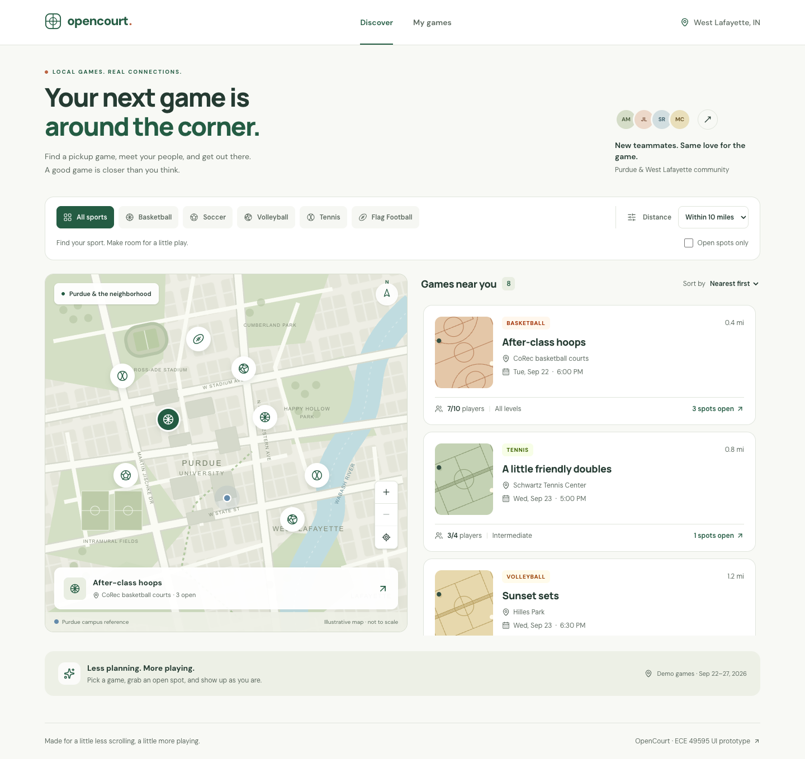

# ECE 49595 Exercise 3 – UI Skill

**PickupSports** is a responsive pickup sports discovery prototype for the Purdue / West Lafayette community. Find a game, explore its details, and try joining an open spot.

## Demo Video

A new PickupSports recording is required before video submission. Follow the [recording sequence](docs/video/README.md). The previous recording has been withdrawn because its UI branding is outdated.

## Exercise 5 Update (continued by Soham Pandey)

Exercise 5 continues this prototype using the next steps from the Exercise 3 plan:

1. **Project-format game data.** Games are now `GameRecord` objects (`src/lib/game-records.ts`) in the shape the team's REST API will return: snake_case fields, ISO start/end times, and a venue with real latitude and longitude. `toGame()` in `src/lib/games.ts` converts a record into the view model the components already used, so the cards and filters did not have to change.
2. **API route.** `GET /api/games` (`src/app/api/games/route.ts`) serves those records, and `GameProvider` loads the Discover list from it. When the backend exists, only the route needs to change.
3. **Real map and the user's location.** The illustrative SVG map was replaced with a Leaflet map using OpenStreetMap tiles (no API key needed). Markers sit at each venue's real coordinates. **Use my location** asks the browser for the user's position, centers the map there, shows a "You are here" marker, and recalculates every distance with the haversine formula (`src/lib/geo.ts`). If location is blocked or unsupported, distances fall back to Purdue Memorial Union.
4. **Map and card sync.** The selected game lives in `GameProvider`. Clicking a marker highlights its card and scrolls the results list to it. **Show on map** on a card highlights its marker, flies the map to it, and opens the preview.
5. **Tests.** New Playwright tests cover marker-to-card sync, card-to-marker sync, keyboard activation of markers, the API response shape, geolocation (granted and blocked), and the updated filter counts. Map tiles are stubbed in tests so they run offline.

Fixes found along the way: Leaflet 1.9 markers could be focused but not activated with Enter or Space (now handled), and cards with one open spot said "1 spots open".

## Technical Skill

Responsive, component-based React UI development using Next.js and Tailwind CSS.

## Project Relevance

Our semester project is a geolocation-based application for discovering nearby pickup sports games. My responsibility is the UI/frontend. This prototype develops the component design, React state, navigation, and responsive layout skills that will be directly used in that application. The typed mock data can later be replaced with backend results, and the illustrative map can be replaced with a real mapping service.

## What I Built

- **Discover page** with eight fictional Purdue / West Lafayette games across five sports.
- **Map UI** with a Leaflet/OpenStreetMap map, selectable game markers at real venue coordinates, a game preview, zoom, reset, and Use my location controls.
- **Game cards** with sport, location, distance, date, time, skill level, and player capacity.
- **Sport filtering** for basketball, soccer, volleyball, tennis, and flag football.
- **Distance filtering** for 1, 2, 5, and 10 miles, combined with the sport selection.
- **Game details screen** at `/games/[id]`, with date, time, location, host, equipment notes, and a join button.
- **Responsive layout**: filters above a map/list split on desktop; map, filters, and a full game list stacked on mobile.
- **Reusable React components**, including `Navbar`, `GameCard`, `FilterBar`, and `MapPanel`.
- Open-spots filtering, distance/date sorting, empty states, a custom 404, keyboard focus styles, and a skip link.
- Capacity-aware demo join/leave actions and a **My games** view. Player totals update across views.



## Learning Objectives

1. Build an interface using at least four reusable React components.
2. Implement at least two interactive UI behaviors using React state.
3. Implement navigation between at least two application views.
4. Create a layout that works at both desktop and mobile screen sizes.

| Objective           | Implementation evidence                                                                               |
| ------------------- | ----------------------------------------------------------------------------------------------------- |
| Reusable components | `src/components/navbar.tsx`, `game-card.tsx`, `filter-bar.tsx`, `map-panel.tsx`                       |
| Interactive state   | Sport/distance/open-spots filters in `GameProvider`; selection/zoom in `MapPanel`; join/leave actions |
| Navigation          | Next.js links between `/`, `/games/[id]`, and `/my-games`, plus Back to Discover                      |
| Responsive layout   | Tailwind `sm:`, `lg:`, and `xl:` utilities; mobile map-first ordering; desktop side-by-side columns   |

## Running the Project

Use **Node.js 22.13 or newer** (Node.js 24 LTS recommended) and npm.

```bash
cd ece49595-exercise3-ui
npm install
npm run dev
```

Open [http://localhost:3000](http://localhost:3000).

For a fresh clone:

```bash
git clone https://github.com/PranavBalaji122/ece49595-exercise3-ui.git
cd ece49595-exercise3-ui
npm ci
npm run dev
```

For the optimized production version:

```bash
npm run build
npm start
```

There are no required environment variables, accounts, API keys, or backend services. The map loads tiles from OpenStreetMap, so it needs an internet connection. Fonts are installed locally with Fontsource, so loading or building the interface does not request Google Fonts.

## Project Structure

```text
src/
├── app/
│   ├── page.tsx                 # Discover route
│   ├── layout.tsx               # Shared provider, navigation, and footer
│   ├── globals.css              # Tailwind theme, fonts, focus and map marker styles
│   ├── icon.svg                 # Original PickupSports mark
│   ├── not-found.tsx            # Unknown game / route fallback
│   ├── api/games/route.ts       # GET /api/games (project-format records)
│   ├── games/[id]/page.tsx      # Typed dynamic game route
│   └── my-games/page.tsx        # Joined games route
├── components/
│   ├── navbar.tsx               # Navbar, Brand, Footer
│   ├── game-card.tsx            # Reusable game summary + Show on map
│   ├── filter-bar.tsx           # Controlled filter inputs
│   ├── map-panel.tsx            # Map overlays: label, location status, preview
│   ├── game-map.tsx             # Leaflet map, markers, user location (client only)
│   ├── court-art.tsx            # Reusable vector court illustrations
│   ├── sport-icon.tsx           # Original sport symbols
│   ├── discover-explorer.tsx    # Filtering, sorting, map/card sync
│   ├── game-details.tsx         # Details and capacity-aware RSVP
│   ├── game-provider.tsx        # Games from the API, filters, selection, location
│   └── my-games.tsx             # Joined games and empty state
└── lib/
    ├── game-records.ts          # GameRecord (API format) and demo records
    ├── games.ts                 # Game view model, toGame(), formatters
    └── geo.ts                   # Coordinates, campus reference, haversine distance
tests/discovery.spec.ts          # Browser behavior and accessibility tests
playwright.config.ts             # Desktop/mobile test projects
docs/
├── evidence.md                  # Screenshot instructions and paste-ready captions
├── verification.md              # Commands and actual verification results
└── screenshots/                 # Exercise 3 images, plus exercise5/ for Exercise 5
```

## How the UI Works

`GameProvider` uses React state to hold filters and joined game IDs above the route content. This preserves those values during Next.js client navigation, including Back to Discover. State intentionally resets on a browser refresh; there is no account or persistent storage.

`DiscoverExplorer` derives one filtered and sorted array from the typed fixtures and passes the same array to the game list and map. Combining filters therefore uses AND behavior: Basketball + 2 miles shows only basketball within 2 miles. Nothing matches? The empty state offers a reset action.

The details route resolves its ID on the server and passes a serializable game object to the interactive details component. `generateStaticParams` prebuilds all eight game pages. Unknown IDs use `notFound()`. The provider checks capacity before adding a player, and the details button disables joining a full game. Leaving restores the original count.

## Verification

```bash
npm run lint
npm run typecheck
npm run build
npm run test:e2e
```

The browser tests use an installed **Google Chrome** with an isolated test profile. The screenshot test writes Exercise 5 images to `docs/screenshots/exercise5/` and needs internet access for map tiles; every other test stubs the tiles. They do not use your normal browser profile. `npm run test:e2e` starts the production server on port 3100, so run `npm run build` first. The suite covers desktop (1440 × 1000) and phone (390 × 664 CSS pixels), and also checks overflow at 320 pixels. Screenshot tests refresh the four PNGs in `docs/screenshots/`.

To use a running dev server instead:

```bash
PLAYWRIGHT_BASE_URL=http://127.0.0.1:3000 npm run test:e2e
```

If Chrome is unavailable, install it, or change the `channel: "chrome"` entries in `playwright.config.ts` to use Playwright's bundled Chromium and run `npx playwright install chromium`.

See [verification results](docs/verification.md) and the [screenshot evidence guide](docs/evidence.md).

## Prototype Boundaries

All games, rosters, hosts, and scheduled activities are fictional records dated October 20–25, 2026, placed at real local venues. They are not live listings. Distances are straight-line miles from Purdue Memorial Union, or from the user's position after they press Use my location; the location stays in the browser and is never sent to a server. Venue access, availability, and actual sporting facilities are not verified by this prototype.

Joining changes only local React state. It does not reserve a venue, contact anyone, or save data to a server. Authentication, hosting, and the real backend are future semester-project work.

## New Work for Exercise 3

This project was created from scratch specifically for ECE 49595 Exercise 3. All UI implementation in this repository is new work for the assignment. The project began with the current official `create-next-app` starter; its default page and branding were replaced with this custom prototype.

## Implementation References

- [Next.js installation](https://nextjs.org/docs/app/getting-started/installation)
- [Next.js layouts and pages](https://nextjs.org/docs/app/getting-started/layouts-and-pages)
- [React: sharing state between components](https://react.dev/learn/sharing-state-between-components)
- [Tailwind responsive design](https://tailwindcss.com/docs/responsive-design)

Exercise 5 references:

- [React Leaflet](https://react-leaflet.js.org/docs/start-introduction/)
- [Leaflet API reference](https://leafletjs.com/reference.html)
- [MDN: Using the Geolocation API](https://developer.mozilla.org/en-US/docs/Web/API/Geolocation_API/Using_the_Geolocation_API)
- [Next.js Route Handlers](https://nextjs.org/docs/app/getting-started/route-handlers)
- [Next.js lazy loading (`ssr: false`)](https://nextjs.org/docs/app/guides/lazy-loading)
- [Playwright emulation (geolocation)](https://playwright.dev/docs/emulation#geolocation)

Framework code, Lucide icons, Fontsource fonts, and Leaflet retain their upstream licenses. Map data © OpenStreetMap contributors. The court illustrations, sport symbols, and PickupSports mark are original SVG code created for this prototype.
